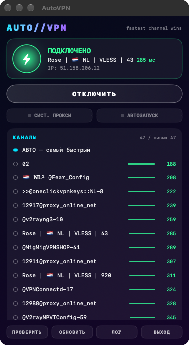
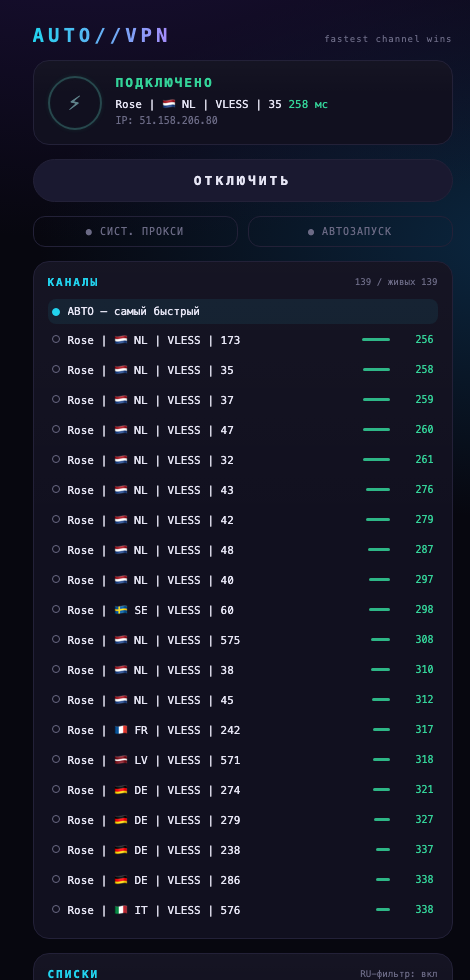

# ⚡ AutoVPN

[Русский](README.md) | **English**

**Self-healing VPN client for macOS, Windows and Linux.** Feed it VLESS subscription lists — it finds the live servers, connects through the fastest one and keeps fixing itself. Zero configuration, zero manual server hopping.


<p align="center">


</p>

> *Fastest channel wins.* While ordinary clients wait for you to click through a hundred servers, AutoVPN probes them all and locks onto the best one.

## Why

Public subscriptions are thousands of links where only a handful are alive — and they die every day. Cycling through them by hand is pain. AutoVPN turns it into a pipeline:

```
subscriptions ──► filter (tls/reality only) ──► sample up to 400
                                                     │
      self-healing ◄── prune dead ◄── probe all ◄────┘
           │
           └─► always connected through the fastest live channel
```

## Two clients, one principle

| | macOS (`macos/`) | Windows / Linux (`desktop/`) |
|---|---|---|
| What it is | Native menu-bar app | Single binary (sing-box bundled) |
| UI | SwiftUI popover at the ⚡ icon | Neon web panel at `127.0.0.1:2082` |
| Language | Swift | Go (pure stdlib) |
| System proxy | one click (networksetup) | one click (WinINET registry / gsettings) |
| Autostart | SMAppService | Run key / autostart .desktop |

Same engine everywhere: sing-box with a urltest group, liveness read from each proxy's delay history, dead-channel pruning with a safety valve (if *everything* died at once, that's your network, not the channels), automatic subscription re-fetch on degradation, a 30-second watchdog.

## Features

- 🚀 **Auto-selection** — sing-box urltest picks the fastest server and fails over instantly
- 📋 **Multiple subscriptions** — add your own URLs, toggle them, plus 5 built-in popular public lists
- 💀 **Dead-channel pruning** — unresponsive channels get deleted (with the safety valve)
- 🏥 **Self-healing** — fewer than 4 live channels, or tunnel down → subscriptions re-fetched automatically
- 🖥 **System proxy** — one button routes the whole OS through the tunnel
- 🧬 **Native** — Swift and Go; no Electron, no Python
- 🌚 **Neon UI** — status orb, ping bars, click a channel to pin it

## Install

The [sing-box](https://sing-box.sagernet.org/) engine is **bundled** in release builds — no separate install.
(Engine license: GPL-3.0-or-later.)

### macOS (menu-bar app)

Grab `AutoVPN.app.zip` from [Releases](../../releases) (ad-hoc signed — on first launch: right-click → Open), or build it:

```bash
git clone https://github.com/alshfu/AutoVPN.git
cd AutoVPN/macos
./scripts/build-app.sh          # downloads sing-box into the .app
cp -R dist/AutoVPN.app ~/Applications/
open ~/Applications/AutoVPN.app
```

### Windows

Download `autovpn-windows-amd64.exe` from [Releases](../../releases) and run it — the panel opens in your browser. The АВТОЗАПУСК (autostart) button registers it to start at login. SmartScreen on first run: "More info" → "Run anyway".

### Linux

```bash
wget https://github.com/alshfu/AutoVPN/releases/latest/download/autovpn-linux-amd64
chmod +x autovpn-linux-amd64
./autovpn-linux-amd64        # panel: http://127.0.0.1:2082
```

`autovpn-linux-arm64` is there too (Raspberry Pi, ARM servers).

Build the Go client from source with a bundled engine:

```bash
cd desktop
../scripts/fetch-singbox.sh "$(go env GOOS)" "$(go env GOARCH)" third_party
go build
```

Without `fetch-singbox.sh` the binary falls back to a system `sing-box` (Homebrew / distro packages).

## Usage

1. Open the panel (macOS: click ⚡ in the menu bar; Windows/Linux: http://127.0.0.1:2082)
2. Paste a subscription URL under СПИСКИ (raw `vless://` lines or base64), or expand the top-5 presets and add one
3. Done. It fetches, probes and connects through the fastest live server
4. SOCKS/HTTP proxy lives at `127.0.0.1:2080`; the system-proxy button routes everything through it

Manual: `curl --proxy socks5h://127.0.0.1:2080 https://api.ipify.org`

## Under the hood

- Only `vless://` with `security=tls|reality` is accepted; RU exits are filtered (optional)
- Big lists are evenly sampled down to 400 channels — sing-box needs no more
- Liveness comes from each proxy's `history` in `GET /proxies`, not from the group delay endpoint (which returns `{}` instantly in sing-box 1.14)
- Garbage uTLS fingerprints (`fp=unsafe`) are whitelisted away; reality without a fingerprint gets `chrome`; flow is normalized to `xtls-rprx-vision`
- Config passes `sing-box check` before every start; a watchdog probes the tunnel end-to-end every 30 s
- Files: macOS `~/Library/Application Support/AutoVPN/`, Windows `%AppData%\AutoVPN\`, Linux `~/.config/AutoVPN/`

## License

[MIT](LICENSE). Use VPNs in accordance with the laws of your country.
