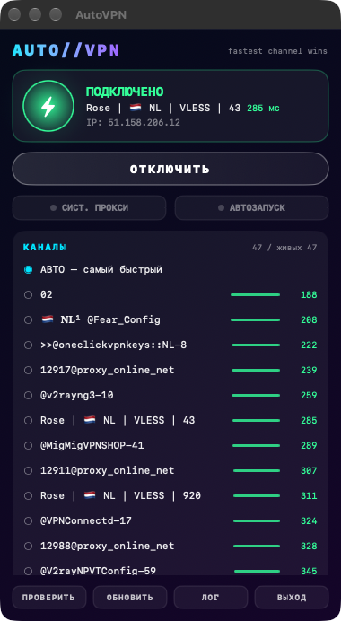

# ⚡ AutoVPN

**Самонаводящийся VPN-клиент для macOS.** Добавляешь подписку с VLESS-ссылками — он сам находит живые серверы, подключается через самый быстрый и сам себя чинит. Ноль настроек, ноль ручного перебора каналов.


<p align="center"></p>

> *Fastest channel wins.* Пока обычные клиенты ждут, что ты сам потыкаешь по сотне серверов, AutoVPN проверяет их все и держится за лучший.

## Зачем

Публичные подписки — это тысячи ссылок, из которых живы единицы, и они умирают каждый день. Перебирать их руками в обычном клиенте — боль. AutoVPN превращает это в конвейер:

```
подписки ──► фильтр (tls/reality, мусор мимо) ──► выборка до 400
                                                       │
     самолечение ◄── удаление мёртвых ◄── замер всех ◄─┘
          │
          └─► всегда подключён через самый быстрый живой канал
```

## Возможности

- 🚀 **Авто-отбор** — urltest-группа sing-box сама выбирает быстрейший сервер и мгновенно переключается при падении
- 📋 **Несколько подписок** — добавляй свои URL, включай/выключай точкой, плюс 5 вшитых популярных списков
- 💀 **Чистка мёртвых** — каналы без отклика удаляются (с предохранителем: если умерли все разом — это сбой сети, не трогаем)
- 🏥 **Самолечение** — живых каналов меньше 4 или туннель упал → подписки перекачиваются автоматически
- 🖥 **Системный прокси** — одна кнопка, и весь Mac идёт через туннель (SOCKS через `networksetup`)
- 🔌 **Автозапуск** — вход в систему через `SMAppService`
- 🧬 **Нативный** — Swift + SwiftUI, живёт в строке меню, без Electron и без Python
- 🌚 **Неоновый UI** — статус-орб, пинг-бары, клик по каналу = закрепить

## Установка

Нужен [sing-box](https://sing-box.sagernet.org/):

```bash
brew install sing-box
```

Сборка из исходников (Xcode Command Line Tools):

```bash
git clone https://github.com/alshfu/AutoVPN.git
cd AutoVPN
./scripts/build-app.sh
cp -R dist/AutoVPN.app ~/Applications/
open ~/Applications/AutoVPN.app
```

Или скачай готовый `AutoVPN.app.zip` из [Releases](../../releases) (подпись ad-hoc — при первом запуске: правый клик → «Открыть»).

## Как пользоваться

1. Клик по ⚡ в строке меню
2. В «СПИСКИ» вставь URL подписки (сырые `vless://`-ссылки или base64) — или раскрой «ТОП-5 ПОПУЛЯРНЫХ» и добавь готовый
3. Всё. Клиент скачает список, проверит каналы и подключится через самый быстрый
4. SOCKS-прокси доступен на `127.0.0.1:2080`; кнопка «СИСТ. ПРОКСИ» заворачивает весь трафик Mac

Прокси вручную: `curl --proxy socks5h://127.0.0.1:2080 https://api.ipify.org`

## Под капотом

- Принимаются только `vless://` с `security=tls|reality` — остальное отбрасывается, включая RU-выходы (опция)
- Из больших списков берётся равномерная выборка до 400 каналов — больше sing-box не нужно
- Живость меряется не групповым delay-эндпоинтом (он в sing-box 1.14 отвечает `{}` мгновенно), а историей задержек каждого канала из `GET /proxies`
- Мусорные uTLS-отпечатки из ссылок (`fp=unsafe` и прочее) фильтруются по белому списку; reality без отпечатка получает `chrome`
- Конфиг проверяется `sing-box check` до запуска; watchdog каждые 30 с проверяет туннель сквозным запросом
- Файлы: `~/Library/Application Support/AutoVPN/` (settings.json, channels.json, singbox.json, логи)

## English

**Self-healing VPN client for macOS.** Feed it VLESS subscription URLs — it filters junk, probes every server, connects through the fastest one and keeps healing itself: dead channels get pruned, and when fewer than 4 remain alive it re-fetches your subscriptions automatically. Native Swift menu-bar app powered by [sing-box](https://sing-box.sagernet.org/) (`brew install sing-box`, then build with `./scripts/build-app.sh`). System-wide SOCKS proxy toggle, login item, neon SwiftUI popover. MIT.

## Лицензия

[MIT](LICENSE). Используйте VPN в соответствии с законами вашей страны.
